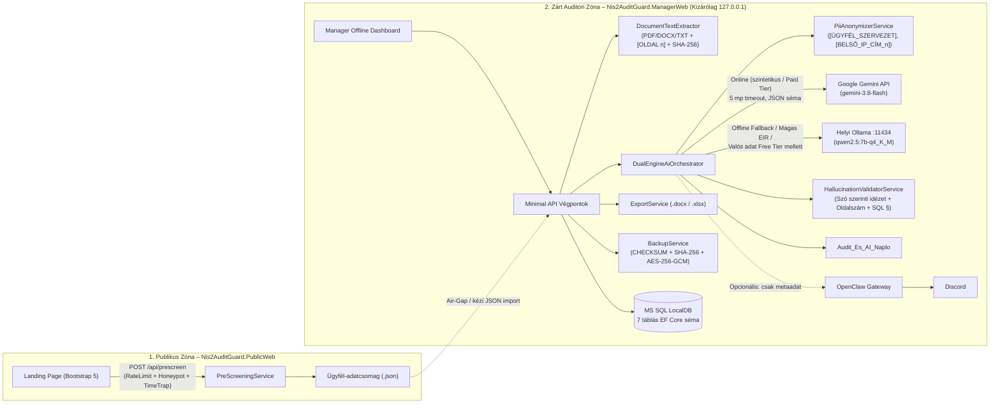
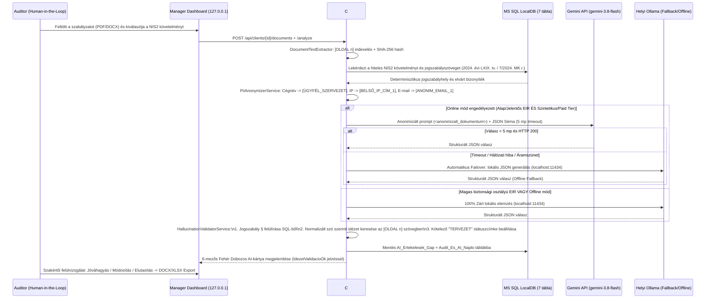

# High-Level Design (HLD) és Rendszerarchitektúra – NIS2-AuditGuard

* **Készítette:** Károlyi Béla (Neptun-kód: `FULABV`)
* **Verzió:** 2.0 (2026. november 4. – Szinkronizálva az ADR-01..13 döntésekkel)

---

## 1. Architektúra Összefoglaló

A **NIS2-AuditGuard** egy kétzónás („Zero Public Exposure”), négyrétegű **C# ASP.NET Core (.NET 10 LTS)** webalkalmazás-rendszer, amely mögött helyi **MS SQL Server LocalDB** (fejlesztői/teszt környezetben SQLite fallbackkel) áll. A két zóna fizikailag külön webprojektben (`Nis2AuditGuard.PublicWeb` és `Nis2AuditGuard.ManagerWeb`) fut, közös üzleti és adatrétegre (`Nis2AuditGuard.Core`) építve.

* **Frontend:** HTML5, CSS3, Bootstrap 5 statikus felületek (`wwwroot`) + Fetch API (Minimal API végpontokhoz kötve, külső követő-scriptek és reCAPTCHA nélkül).
* **Backend:** C# ASP.NET Core 10.0 (`net10.0`), Entity Framework Core 10, `PdfPig` (oldalszám-hű PDF szövegkinyerés), `DocumentFormat.OpenXml` (`.docx` olvasás és vezetői összefoglaló export), `ClosedXML` (`.xlsx` Gap-mátrix export).
* **Adatbázis:** MS SQL Server Express / LocalDB – 7 relációs táblával, 100%-ban belföldi/lokális adattárolással (2024. évi LXIX. tv. 9. § és 22. § (1) g)).
* **AI Motor („B” architektúra – C# Dual-Engine Smart Failover, ADR-09 & ADR-10):**
  * **Primary Engine (Online):** Google Gemini Interactions API (`/v1beta/interactions`, modell: `gemini-3.8-flash`, `x-goog-api-key` fejléc, `temperature = 0.1`, kényszerített `response_format` JSON séma). Előtte kötelező lokális C# `PiiAnonymizerService` maszkolás. *Ingyenes (Free Tier) API-kulcs esetén kizárólag szintetikus demó-dokumentumok küldhetők online!*
  * **Fallback / Offline Engine (Lokális):** Helyi `localhost:11434` végponton futó **Ollama** (`qwen2.5:7b-instruct-q4_K_M` kvantált modell). Automatikusan aktiválódik 5 másodperces API-időtúllépés, internetkiesés, áramszünet (UPS üzem), „Magas” biztonsági osztályú EIR, vagy ingyenes kulcs melletti valós ügyféldokumentum esetén.
  * **Opcionális értesítő:** Lokális **OpenClaw Gateway** → Discord csatorna (kizárólag anonim metaadat: darabszámok és státuszok; ügyféladat és idézet soha nem továbbítható).

---

## 2. Zónák és Webbiztonsági Elemek

### 2.1. Külső Zóna (`Nis2AuditGuard.PublicWeb` – Landing Page)
* **Cél:** Új ügyfelek tájékoztatása, 20–30 kérdéses NIS2 érintettségi előszűrés, determinisztikus irányár-kalkuláció (az 1/2025. SZTFH rendelet logikájával) és offline átvihető `.json` ügyfélcsomag előállítása.
* **Zero Public Exposure (ADR-05):** A publikus alkalmazásban **nincs** `/admin` vagy `/login` végpont; a belső rendszer kívülről nem érhető el.
* **Webes védelem (DDoS, Spam, OWASP):**
  * **Rate Limiting:** ASP.NET Core IP-alapú `FixedWindowLimiter` (max. 5 kérés / perc az előszűrő végponton; túllépéskor `HTTP 429 Too Many Requests`).
  * **Lokális Honeypot + Time-Trap:** CSS-sel elrejtett `WebsiteUrlHoneypot` mező és `UrlapMegnyitasUnixSec` időbélyeg. Ha a csapdamező nem üres, vagy a beküldés 3 másodpercnél gyorsabb, a szerver `HTTP 400`-zal elutasítja a kérést (nincs szükség külső Google reCAPTCHA-ra).
  * **Anti-CSRF és Security Headers:** Antiforgery token validáció, szigorú `Content-Security-Policy`, `X-Content-Type-Options: nosniff`, `X-Frame-Options: DENY`.

### 2.2. Belső Zóna (`Nis2AuditGuard.ManagerWeb` – Auditor Dashboard)
* **Hálózati izoláció:** A Kestrel kizárólag a `http://127.0.0.1:5080` címen figyel, és egy dedikált middleware `HTTP 403 Forbidden` válasszal blokkol minden nem-loopback kérést.
* **Fő modulok:**
  1. Ügyfél-adatcsomag (`.json`) importálása és EIR biztonsági osztály (`Alap`, `Jelentos`, `Magas`) kezelése.
  2. Szabályzatok és bizonyítékok (`.pdf`, `.docx`, `.txt`) biztonságos feltöltése, SHA-256 integritás-lenyomattal és `[OLDAL n]` indexeléssel.
  3. **1. Lépés – Lokális PII-Anonimizáló Előnézet:** Az auditor a küldés előtt látja a maszkolt szöveget és a cserék statisztikáját.
  4. **2. Lépés – Fehér Dobozos Gap-Analízis:** 6 kötelező átláthatósági mező, kötelező jogszabályi előírás vs. AI jó gyakorlat szétválasztása, C# idézet-validáció visszajelzése és Human-in-the-Loop jóváhagyás (`TERVEZET` → `JÓVÁHAGYVA` / `ELUTASÍTVA`).
  5. **3-szintű Vezetői Összefoglaló és Export:** Ügyvezetői, IT vezetői és Auditori nézet exportálása valódi Word (`.docx`) és Excel (`.xlsx`) fájlokba.
  6. **3-2-1-1-0 DRP Backup Konzol:** Adatbázis-mentés, AES-256-GCM titkosítás és Visszaállítási Próba Jegyzőkönyv generálása.

---

## 3. Folyamatábra (Dokumentumelemzés, Failover és Hallucináció-szűrés)

---

## 4. Adatvédelmi Pajzs és Determinisztikus Hallucináció-szűrő

1. **`PiiAnonymizerService` (Lokális DLP maszkolás):**
   A C# szolgáltatás reguláris kifejezésekkel és cégnév-variáns szótárral standardizált, sorszámozott tokenekre cseréli az érzékeny adatokat: `[ÜGYFÉL_SZERVEZET]`, `[ANONIM_SZEMELY_1]`, `[ANONIM_EMAIL_1]`, `[BELSŐ_IP_CÍM_1]`, `[ANONIM_TELEFON_1]`, `[ANONIM_ADOSZAM_1]`, `[ANONIM_CEGJEGYZEKSZAM_1]`, `[ANONIM_BANKSZAMLA_1]`, `[BELSŐ_HOSZTNÉV_1]`. A token-térkép kizárólag a helyi memóriában marad.
2. **`HallucinationValidatorService` (Idézet- és Forrás-validáció):**
   Nem bizonytalan Levenshtein-távolságot használ, hanem whitespace- és idézőjel-normalizált **szó szerinti részsztring-keresést** (`IndexedDocument.FindExact`) végez az oldalanként indexelt dokumentumon, beleértve az oldalhatáron átnyúló idézeteket is. Ellenőrzi továbbá, hogy a találat oldalszáma egyezik-e az AI által megjelölt oldallal. Ha az idézet nem található, a kártya `IdezetValidacioOk = false` értéket és `⚠️ HALLUCINÁCIÓ-GYANÚ` figyelmeztetést kap, miközben a státusz `TERVEZET – SZAKÉRTŐI FELÜLVIZSGÁLAT SZÜKSÉGES` marad.
